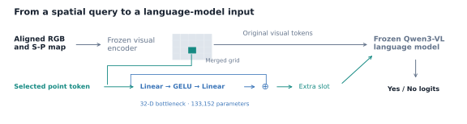
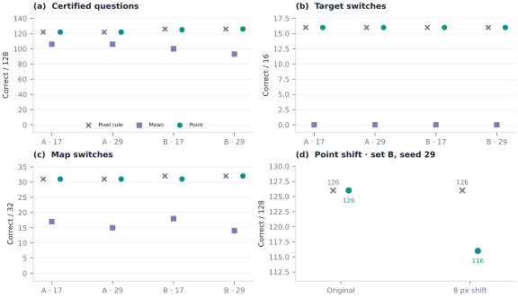

# GroundReach

GroundReach tests whether a frozen vision-language model can use an aligned workspace map to answer questions about a particular surface point in Panda simulation. It uses a **133,152-parameter** residual adapter on Qwen3-VL-2B-Instruct.

## Method



The adapter reads the merged map token at the automatically located point and inserts one additional embedding. A parameter-matched baseline reads the region mean. Both use the same frozen backbone, crops and Yes/No scoring. [Method](docs/method.md) · [Benchmark](docs/benchmark.md)

## Main results

| Metric | Point adapter | Region-mean adapter |
| --- | ---: | ---: |
| Certified questions | **122–126/128** | 93–106/128 |
| Both answers correct when switching the target | **16/16 in each evaluation** | 0/16 |
| Both answers correct when switching the map | **31–32/32** | 14–18/32 |

Ranges cover two seeds evaluated on both confirmation sets. Swapping the extra token across maps reduced the primary runs to 0/32 map-switch pairs. With one measured 8-pixel point shift, the adapter fell from 126/128 to 116/128 while the pixel rule stayed at 126/128. [Predictions and certificates](results/grounding-study/point-token-pilot)



## Quick start

```bash
python -m pip install -e .
groundreach-reproduce
```

CPU replay uses published predictions. GPU inference with saved heads, training and simulator setup are covered in the [reproduction guide](docs/reproduction.md).

## References

[PhysVLM](https://openaccess.thecvf.com/content/CVPR2025/html/Zhou_PhysVLM_Enabling_Visual_Language_Models_to_Understand_Robotic_Physical_Reachability_CVPR_2025_paper.html) · [Qwen3-VL](https://huggingface.co/Qwen/Qwen3-VL-2B-Instruct) · [Grounding DINO](https://arxiv.org/abs/2303.05499) · [CLIP](https://proceedings.mlr.press/v139/radford21a.html)