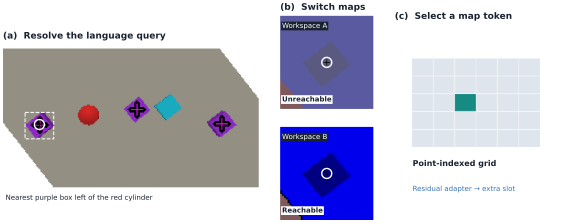
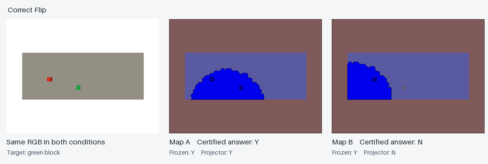

# GroundReach

**Point-Conditioned Visual Adaptation for Robotic Spatial Reachability**

GroundReach asks whether a vision-language model can use the part of a workspace map that corresponds to the point named in a question. The latest system trains a **133,152-parameter** residual adapter on a frozen Qwen3-VL-2B-Instruct backbone and tests whether its answers change correctly when either the queried point or the map changes.



The crosshair marks the same point in two aligned map crops. Strong color saturation indicates workspace membership. The feature grid is schematic.

[Method](#point-token-method) · [Main results](#counterfactual-results) · [Reproduce](#recompute-the-counterfactual-scores) · [Next experiments](study/NEXT_EXPERIMENTS.md)

## Point-token method


1. Resolve the target from RGB and the relational question, and read the visible marker on that target. Use the available automatic points to define a shared crop for the aligned RGB scene and workspace map.
2. Select the merged map token covering the queried point from the frozen visual feature grid. Pass it through a residual MLP with a 32-dimensional bottleneck and inject the adapted vector into one additional embedding slot. The original visual inputs and the language model remain frozen.
3. Score the next-token logits for **Yes** and **No**. Supervise the adapter with independently certified labels for tool-link position reachability in static Panda simulation. Reachable points have an IK/FK witness within joint limits. Certified unreachable points are outside a conservative URDF bound. [Implementation](study/train_physical_token.py) · [Label semantics](LABEL_SEMANTICS.md)

The region-mean control uses the same automatic points, crops, frozen backbone, and adapter parameter count. Only the map feature supplied to its adapter changes. The interface check verified identical logits for the native and cached visual forward paths and after saving and reloading an adapter. [Interface check](results/grounding-study/point-token-pilot/point-token-interface) · [Full experiment protocol](study/关系指代与可达性实验报告.md#point-conditioned-token-训练小试)

## Counterfactual results


**Visualization only.** Teal shows the workspace mask derived from the original map, gray its complement. Read across for a map switch and down for a target switch. Labels come from the certified manifest.

Both heads train on **416 questions from 104 layouts**. There are 20 separate development layouts and two disjoint confirmation sets of 32 layouts each. Each confirmation layout crosses two targets with two workspace maps. The second set changes the association between relation direction and layout pattern. The table shows the range across two training seeds evaluated on both sets. A switch pair counts only when both answers are correct.

| Metric | Point-token adapter | Parameter-matched region-mean adapter |
| --- | ---: | ---: |
| Certified questions correct | **122–126/128** | 93–106/128 |
| Same map, switch the target | **16/16 in all four evaluations** | 0/16 in all four |
| Same target, switch the map | **31–32/32** | 14–18/32 |


A and B denote confirmation sets, and 17 and 29 denote training seeds. Panel (d) shows the two measured conditions.

- **Feature intervention.** Replacing only the additional point token with the same target’s token from the alternate map dropped map-switch accuracy to **0/32** in each of the two primary evaluations. Direct injection without a learned adapter was also weak. [Primary confirmation](results/grounding-study/point-token-pilot/point-token-automatic) · [Counterbalanced confirmation](results/grounding-study/point-token-pilot/point-token-automatic-permuted) · [Seed 17 cross-check](results/grounding-study/point-token-pilot/point-token-cross-check-17) · [Seed 29 cross-check](results/grounding-study/point-token-pilot/point-token-cross-check-29)
- **Pixel-rule comparison.** The deterministic pixel rule matched point-adapter scores in the clean evaluations. In one paired stress test, an 8-pixel point shift reduced the point adapter from **126/128 to 116/128**, while the pixel rule remained at **126/128**. [Shifted-point predictions and statistics](results/grounding-study/point-token-pilot/point-token-jitter)
- **Scope.** Automatic points covered **122/128** and **126/128** questions across the two sets. Missing points count as unanswered. The protocol uses visible markers, aligned maps, static simulation, and forced Yes/No scoring. Its labels certify position reachability. Pose-constrained grasping, collision-free trajectories, and physical robot performance require separate evaluation. [Certificate protocol](study/关系指代与可达性实验报告.md#实验怎样区分目标锚点和地图)

## Recompute the counterfactual scores

From the repository root, use Python with NumPy and Pillow. This replays published predictions and computes uncertainty by resampling layouts.

```bash
pilot=results/grounding-study/point-token-pilot

python study/summarize_physical_tokens.py \
    --manifest "$pilot/point-token-confirm/manifest.json" \
    --predictions "$pilot/point-token-automatic/predictions.json" \
    --output point-token-confirm-paired.json

python study/summarize_physical_tokens.py \
    --manifest "$pilot/point-token-permuted/manifest.json" \
    --predictions "$pilot/point-token-automatic-permuted/predictions.json" \
    --output point-token-permuted-paired.json
```

For fresh model inference or training, the [full protocol](study/关系指代与可达性实验报告.md#point-conditioned-token-训练小试) documents the split seeds, rendering flags, localization predictions, and published heads. The existing trainer accepts `--load-heads` for inference with saved adapters. Rendering the raw inputs requires the simulator and model dependencies. [Training entry point](study/train_physical_token.py) · [Manifests and head checkpoints](results/grounding-study/point-token-pilot)

## Earlier studies



*An example from the earlier PhysVLM study illustrates the map intervention. The scene and target stay fixed. The map changes, and the certified answer flips.*

| Study | Result |
| --- | --- |
| [Anchor binding](study/关系指代与可达性实验报告.md) | On 32 held-out layouts, explicit anchor selection improved joint target localization from **8/32 to 30/32** and certified reachability from **87/128 to 124/128** against the earlier box-center relation rule. Both remaining localization misses lacked the correct anchor proposal. |
| [Specified-point PhysVLM study](study/marked-point-study.md) | In the earlier PhysVLM setup, ranking followed by a marked-pixel rule answered **200/231** certified questions. Simulator point coordinates increased that to **231/231**. [Original marked-point reproduction](https://github.com/Yamila56/Groundreachvlm/blob/272a98a3970e1210a87bc1a010e5bf730a9af584/README.md#reproduce) |
| [Frozen feature probe](study/关系指代与可达性实验报告.md#冻结视觉特征探针结果) | A linear probe on frozen map tokens selected at the query point passed **32/32** target switches and **32/32** map switches under a separate probe protocol. |

## References

GroundReach uses [PhysVLM’s S-P Maps and Panda simulator](https://openaccess.thecvf.com/content/CVPR2025/html/Zhou_PhysVLM_Enabling_Visual_Language_Models_to_Understand_Robotic_Physical_Reachability_CVPR_2025_paper.html). The locator uses [Grounding DINO](https://arxiv.org/abs/2303.05499) and [CLIP](https://proceedings.mlr.press/v139/radford21a.html). The point adapter uses the [Qwen3-VL-2B-Instruct checkpoint](https://huggingface.co/Qwen/Qwen3-VL-2B-Instruct).

Regenerate the README figures with Python, NumPy, Matplotlib and Pillow by running `python scripts/figures/render.py` from the repository root. [Plotting source](scripts/figures/render.py) · [SVG and 300 dpi PNG figures](assets/figures)
