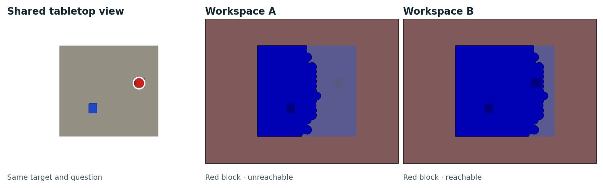

# Workspace Reachability Pairs

Given a fixed tabletop view, can a vision-language model change its answer when the robot's workspace changes? This study holds the camera, visible objects, target and question fixed. It changes the mounting position of a simulated Franka Panda and renders a corresponding Spatial-Physical Map for each position.



Each pair has two independent geometry checks. A joint-limited inverse-kinematics solution with a verified end-effector position certifies reachability. A conservative bound derived from the URDF certifies clear out-of-range targets. The task concerns the position of one visible surface point with free tool orientation.

## Evaluation

- **Changing reachability** measures how often the model answers both sides of a pair correctly when the reference answer changes.
- **Stable reachability** measures how often both answers remain correct when the reference answer stays the same.
- A swapped-map control changes the input map while retaining the original reference labels. A workspace nearest-neighbor rule and a radial distance rule provide geometry comparisons.

The CPU fixture generator and offline GPU evaluation are independent stages. Each fixture records the shared RGB hash, camera calibration, target coordinate, workspace maps, and the supporting IK or geometric bound.

The evaluation set contains 160 independent scenes, with 40 in each of the four paired label combinations. The scene generator draws target and distractor colors independently of the assigned reachability combination.

## Results

| Method | Changing pairs, both correct | Stable pairs, both correct |
| --- | ---: | ---: |
| PhysVLM-3B | 0/80 | 40/80 |
| PhysVLM-3B with swapped maps | 0/80 | 40/80 |
| Workspace nearest neighbor | 80/80 | 80/80 |
| Radial distance | 80/80 | 80/80 |

Under deterministic decoding, PhysVLM answered Yes on all 320 questions. Changing the map changed the first-token logits in both development probes while the decoded answer stayed constant. The geometry rules used the target's 3D position. [Experiment report](study/实验报告.md) · [Metrics](results/results.json) · [Predictions](results/predictions.jsonl)

## Run

From the repository root, fetch the reference implementation and prepare the simulation environment. The pinned upstream checkout provides the simulator assets, map encoder and model architecture.

```bash
git clone https://github.com/jetteezhou/PhysVLM.git upstream
git -C upstream checkout 37e25fd83d8b9f0bdb425661e2dcdffa674a79c7
export PHYSVLM_UPSTREAM="$PWD/upstream"
bash study/setup_cpu_env.sh
pilot_env="${PHYSVLM_PILOT_ENV:-$HOME/.local/share/physvlm-reachability}"
LD_LIBRARY_PATH="$pilot_env/native/usr/lib/x86_64-linux-gnu${LD_LIBRARY_PATH:+:$LD_LIBRARY_PATH}" \
  "$pilot_env/venv/bin/python" study/generate_paired_dataset.py \
  --output study/outputs/paired-formal --per-stratum 40 --seed-start 1000
```

In a separate Linux environment with CUDA-enabled PyTorch and torchvision, install the model dependencies and download the public checkpoint to `model/`. The bundled development fixture can be used before generating the full evaluation set.

```bash
export PHYSVLM_UPSTREAM="$PWD/upstream"
python -m pip install transformers==4.37.2 tokenizers==0.15.2 accelerate==0.27.2 \
  safetensors==0.5.3 einops einops-exts shortuuid timm==0.6.13
hf download JettZhou/PhysVLM-Qwen2.5-3B \
  --revision 411280628b973db0c1e58d3e1a22c0dda90729d5 --local-dir model
python study/evaluate_reachability.py --model model --probe \
    --fixtures study/fixtures/panda-paired-dev/paired_pilot.json \
    --output study/outputs/dual-input-probe.jsonl
```

The probe checks that both visual towers consume their inputs, changing the map changes the first-token logits, and rerunning the same input yields the same result.

The following commands rerun the full evaluation using the selected fixtures, then score the predictions. `study/audit_fixtures.py` can also replay the geometry certificates in the simulation environment.

```bash
data=study/outputs/paired-formal
mapfile -t fixtures < <(python - "$data" <<'PY'
import json
import sys
from pathlib import Path

data = Path(sys.argv[1])
for item in json.loads((data / "selection.json").read_text())["selection"]:
    print(data / item["fixture"])
PY
)
python study/evaluate_reachability.py --model model --fixtures "${fixtures[@]}" \
    --output study/outputs/predictions.jsonl
python study/score_reachability.py "$data/selection.json" study/outputs/predictions.jsonl
```

## References

This study evaluates the public PhysVLM checkpoint and reuses its Spatial-Physical Map implementation. The paired scene generation, independent reachability checks, and evaluation are the focus of this project. [PhysVLM paper](https://openaccess.thecvf.com/content/CVPR2025/papers/Zhou_PhysVLM_Enabling_Visual_Language_Models_to_Understand_Robotic_Physical_Reachability_CVPR_2025_paper.pdf) · [Upstream project](https://github.com/jetteezhou/PhysVLM) · [Model checkpoint](https://huggingface.co/JettZhou/PhysVLM-Qwen2.5-3B)
