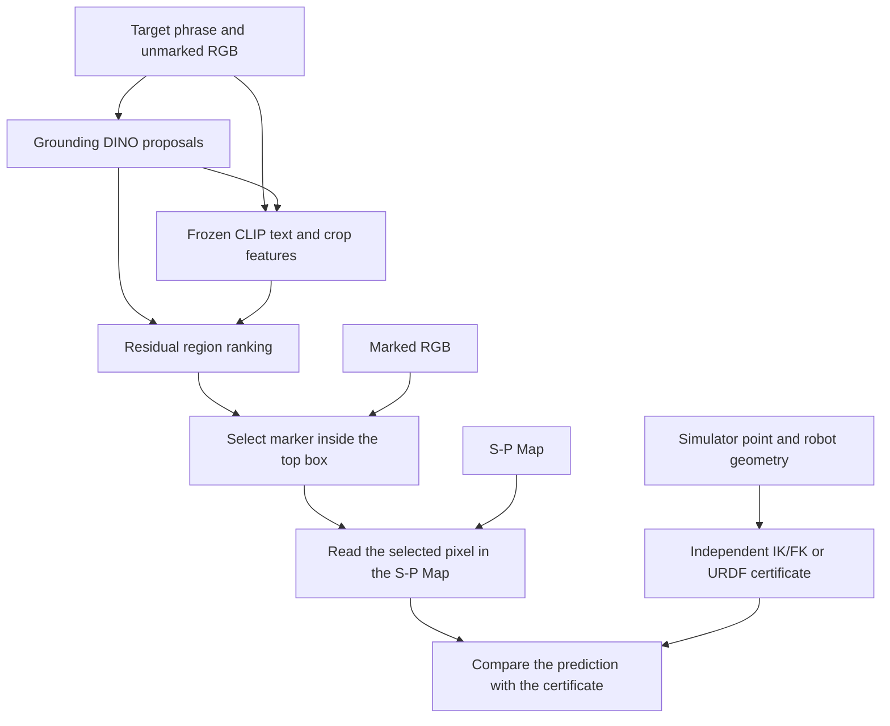

# GroundReach

**Counterfactual evaluation of language-conditioned robotic reachability**

GroundReach asks whether a vision-language model reads the region of a robot workspace map that corresponds to the object named in a question. It extends PhysVLM with paired Panda simulations, a learned region ranker, and independently replayed geometric certificates for specified surface points.

The benchmark holds RGB fixed while crossing two named objects with two workspace maps. Each object carries the same visual marker, and the question selects the object whose marked point is queried. These interventions measure target selection and workspace sensitivity separately.

## Main results

The final held-out test contains **32 physical layouts, 64 views, and 256 questions**. Joint-limited inverse kinematics with forward-kinematics replay certifies 93 reachable cases. A conservative URDF bound certifies 138 unreachable cases. Another 25 questions retain an unknown certificate status. Four-answer accuracy uses the 44 views in which all four labels are certified.

| Target localization and readout | Certified questions correct | All four correct | Both answers correct on map switches |
| --- | ---: | ---: | ---: |
| Frozen PhysVLM, full inputs | 93/231 | 0/44 | 0/93 |
| Grounding DINO top box, center-region map rule | 171/231 | 11/44 | 48/93 |
| Learned residual ranker, center-region map rule | 198/231 | 34/44 | 80/93 |
| **Learned residual ranker, marked pixel** | **200/231** | **34/44** | **80/93** |
| Learned residual ranker, local PhysVLM projector, seeds 17 / 29 | 187/231 · 122/231 | 29/44 · 1/44 | 75/93 · 6/93 |
| Simulator-provided marker coordinate, map readout | 231/231 | 44/44 | 93/93 |

1. **Target selection accounts for the remaining errors of the marked-pixel rule.** The two ranker seeds produce the same final decisions. All 31 incorrect certified answers occur when the target's marker is missed. Given the simulator marker coordinate, the same map rule answers all 231 certified questions correctly. The marker rule gains two correct answers over the center-region rule on the same ranked boxes. [Specified-point study](study/marked-point-study.md) · [Scores](results/grounding-study/marked-point.json) · [Certificate replay](results/grounding-study/marked-point-certificate-audit.json)
2. **Matching the training and inference view matters for the VLM.** In a separate controlled crop experiment, the local projector reaches 48/48 complete views for both seeds when trained and evaluated on target crops. The other three train–test crop combinations reach 0/48. With similar parameter counts and learning-rate search budgets, global LoRA is stronger on target switches and the projector is stronger on workspace switches. [Crossed crop experiment](results/target-repair/crossed-input-metrics.json) · [Capacity-matched comparison](results/capacity-comparison/held-out-metrics.json)
3. **The original simulator labels and specified-point labels answer different questions.** On 128 upstream-recipe questions, learned ranking improves target identity from 73/128 to 90/128 and 89/128, while the corresponding map scores are 92/128 and 93/128 against 94/128 for frozen PhysVLM. The upstream label uses radial distance to an object's origin. The map depicts workspace membership of visible surface pixels, so better object localization need not improve agreement with the radial labels. [Upstream comparison](results/grounding-study/learned-reranker.json) · [Label and map audit](LABEL_SEMANTICS.md)

## Anchor-switch follow-up

A separate simulator split holds the image and direction word fixed while changing the referenced anchor. The original two ranker seeds each localize 17/64 targets. Filtering out marked targets from the anchor candidates and ranking the remaining boxes by appearance improves localization to **62/64** and point reachability to **124/128**, compared with 25/64 and 81/128 for full-phrase detection. Both misses occur when the correct anchor box is absent from the candidate pool. [Relation study](study/关系指代与可达性实验报告.md) · [Confirmation scores](results/grounding-study/relation-study/anchor-confirmation/metrics.json)

On 32 new layouts with both targets visible in the same crop, a linear probe using the frozen map token at the queried point passed **32/32** target switches and **32/32** map switches. Region-mean features passed **0/32** target switches. Frozen Qwen3-VL question answering with the same shared crop and ground-truth point passed **2/32** target switches and **1/32** map switches. [Physical-map probe](study/关系指代与可达性实验报告.md#冻结视觉特征探针结果) · [Paired results](results/grounding-study/relation-study/physical-map-probe-point-confirm/paired.json)

## Point-conditioned physical token

A 133K-parameter residual head adapts one frozen map token selected at the automatically localized point. Across two training seeds and two balanced 32-layout confirmation sets, point-token adaptation passed **16/16** same-map target switches in each evaluation, compared with **0/16** for a parameter-matched region-mean token. It passed **31–32/32** same-target map switches. Exchanging the point token with one from the alternate map reduced the two primary runs to **0/32** map-switch pairs. [Pilot protocol and results](study/关系指代与可达性实验报告.md#point-conditioned-token-训练小试) · [Predictions and residual heads](results/grounding-study/point-token-pilot)

## Method



- **Region ranking.** Grounding DINO provides up to five deduplicated candidates. For each query, the detector score and frozen CLIP cosine similarity are separately standardized across candidates. The score is their mean plus a learned residual, `score = 0.5 × (z_detector + z_CLIP) + MLP(features)`. The 32-unit MLP uses the frozen crop embedding, the text embedding, and their elementwise interaction. A listwise loss rewards the total probability assigned to boxes with IoU ≥ 0.5 against the annotated target. [Ranker implementation](study/train_region_reranker.py) · [Training and transfer protocol](study/目标定位实验报告.md)
- **Workspace readout.** The rule takes the visible marker nearest the center of the highest ranked box, considering only markers inside that box. It classifies the selected pixel by chroma in the unmarked S-P Map. The local projectors and learned readouts were fit on earlier protocols, so this comparison measures their zero-shot transfer to specified points. Projector seed 29 produces 89 ambiguous or unrecognized answers with automatic boxes and 85 with annotated boxes. Taking the first Yes/No raises its scores from 122/231 to 194/231 and from 139/231 to 222/231, respectively. The main results require an unambiguous answer. [Readout implementation](study/evaluate_marked_points.py) · [Scoring details](study/marked-point-study.md)
- **Independent labels.** The certificate replay uses the simulator point and robot geometry. It checks free-orientation tool-link position reachability in the Panda simulation. The main scores cover certified cases and measure point reachability under this protocol. [Certificate audit implementation](study/audit_fixtures.py) · [Geometry definitions](LABEL_SEMANTICS.md)

## Reproduce

Replay the published counts from per-question predictions with Python 3 and its standard library.

```bash
bash study/run_marked_point_study.sh replay --output replayed-metrics.json
```

To regenerate scenes and reproduce inference on Ubuntu x86-64, prepare the pinned simulator and checkpoints. Set `GROUNDING_PYTHON` to a CUDA environment with Transformers 4.57.1, PyTorch, OpenCV and Pillow. Set `VLM_PYTHON` to a CUDA environment with Transformers 4.37.2, tokenizers 0.15.2, Accelerate 0.27.2, safetensors 0.5.3, timm 0.6.13, einops, einops-exts, shortuuid and OpenCV.

```bash
git clone https://github.com/jetteezhou/PhysVLM.git upstream
git -C upstream checkout 37e25fd83d8b9f0bdb425661e2dcdffa674a79c7
export PHYSVLM_UPSTREAM="$PWD/upstream"

bash study/setup_cpu_env.sh
hf download IDEA-Research/grounding-dino-tiny \
    --revision a2bb814dd30d776dcf7e30523b00659f4f141c71 --local-dir models/dino
hf download openai/clip-vit-base-patch32 \
    --revision 3d74acf9a28c67741b2f4f2ea7635f0aaf6f0268 --local-dir models/clip
hf download JettZhou/PhysVLM-Qwen2.5-3B \
    --revision 411280628b973db0c1e58d3e1a22c0dda90729d5 --local-dir models/physvlm
bash study/run_marked_point_study.sh run study/outputs/point-reproduction \
    models/dino models/clip models/physvlm
```

The entry point writes regenerated certificates, model predictions and counts. The two bundled rankers contain the learned residual parameters and split metadata. The simulator, pretrained models, RGB files, workspace files and frozen embedding caches are obtained from the source dependencies or regenerated with the study code. [Specified-point protocol](study/marked-point-study.md) · [Artifact hashes](results/grounding-study/reproduction/sha256.json) · [Split provenance](results/grounding-study/reproduction/split-manifest.json)

In a CPU ablation with frozen candidate boxes, the linear residual reaches 198/231 for both seeds, the MLP without explicit interaction reaches 200/231 and 203/231, and the full MLP reaches 200/231 for both seeds. Uncertainty intervals overlap zero for the interaction ablation. [Ranker ablation](study/ranker-ablation.md) · [Earlier experiments](study/后续实验报告.md)

## References

- PhysVLM provides the S-P Map formulation, source simulation, and pretrained checkpoint. [CVPR 2025 paper](https://openaccess.thecvf.com/content/CVPR2025/html/Zhou_PhysVLM_Enabling_Visual_Language_Models_to_Understand_Robotic_Physical_Reachability_CVPR_2025_paper.html) · [Upstream code](https://github.com/jetteezhou/PhysVLM) · [Checkpoint](https://huggingface.co/JettZhou/PhysVLM-Qwen2.5-3B)
- The ranking pipeline uses pretrained Grounding DINO and CLIP. [Grounding DINO](https://arxiv.org/abs/2303.05499) · [CLIP](https://proceedings.mlr.press/v139/radford21a.html)
