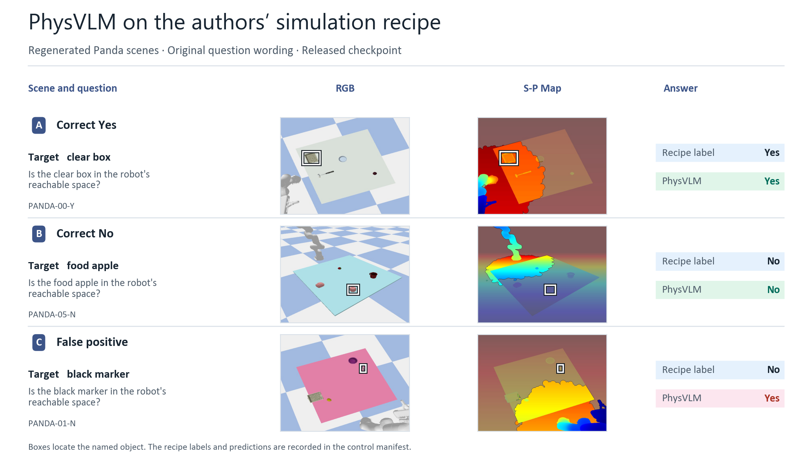
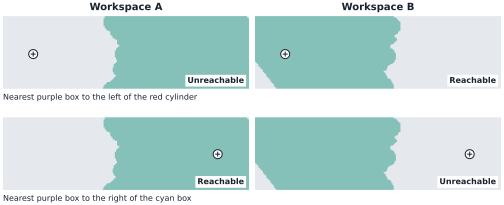
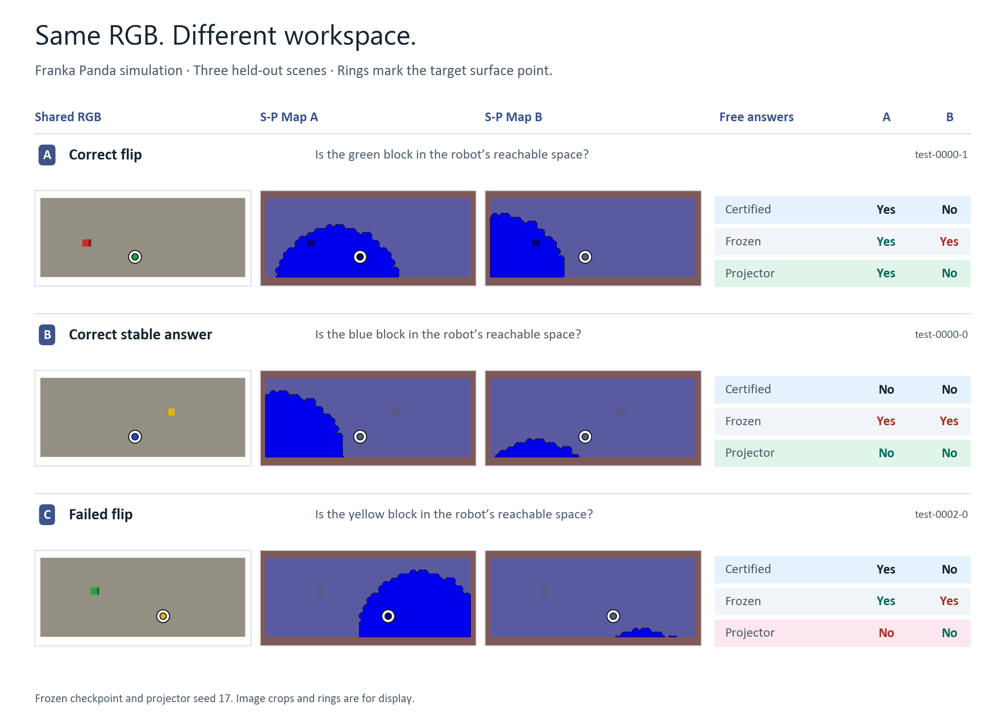

# GroundReach

**Point-Conditioned Visual Adaptation for Robotic Spatial Reachability**

Given an RGB scene, an aligned spatial-physical map (S-P Map), and a language query, can a vision-language model tell whether a particular visible surface point is reachable? GroundReach studies that problem in Panda simulation. It traces the task from reproduction and geometric auditing of PhysVLM to a point-conditioned adapter for frozen Qwen3-VL-2B-Instruct.

## Research overview

1. **PhysVLM reproduction and map audit.** Replay the upstream Panda recipe and test whether the rendered map agrees with the sampled workspace geometry.
2. **Geometry-certified evaluation.** Define reachability for a specified visible point and build fixtures with independent geometric evidence for the label.
3. **Relational target grounding.** Resolve the named target relative to an anchor and recover its marked point. The anchor-switch study keeps the RGB scene and direction word fixed while changing the referenced anchor. [Grounding audit](results/grounding-study/relation-study/anchor-confirmation)
4. **Point-conditioned visual adaptation.** Adapt the local map feature at the grounded position with a small residual head on a frozen Qwen3-VL backbone.
5. **Counterfactual evaluation and feature interventions.** Change the target or the map in paired scenes, then swap the injected feature to test whether predictions depend on that feature.

## Simulation and geometry-certified benchmark



*Earlier PhysVLM reproduction. The gallery shows Panda simulations generated with the original recipe, including the robot view, RGB object scenes and S-P Maps.*

The earlier map audit reproduced the S-P Map files **byte for byte in all 70 Panda scenes**. The geometric workspace mask agreed with the rendered map's chroma rule on **99.85% of 21,504,000 image pixels** and **99.60% of 180,369 visible target pixels**. An independent replay of **27 additional scenes** reproduced all 27 maps byte for byte and reached **99.85%** pixel agreement. [Map audit and label definitions](docs/benchmark.md) · [Independent replay](results/grounding-study/source-map-geometry-replication.json)

The current benchmark addresses the reachability of a designated surface point. A reachable point has a joint-limited inverse-kinematics solution verified by forward kinematics. A certified unreachable point falls outside a conservative URDF-based bound. Unknown labels are tracked outside certified accuracy. The protocol measures position reachability in static simulation. [Certificates and split manifests](results/grounding-study/point-token-pilot)

## Point-conditioned adaptation


The spatial locator recovers the queried marker, and both the RGB image and S-P Map use a shared crop. The frozen visual encoder produces a merged map-token grid. The point head selects the patch containing the query coordinate. A residual MLP with a **32-dimensional bottleneck** and **133,152 trainable parameters** adapts that feature and replaces one additional embedding slot. The regular multimodal inputs stay in the frozen language-model forward pass, and the Yes/No candidate logits determine the answer. The parameter-matched control applies the same head architecture to the region mean. [Method](docs/method.md) · [Point selection](groundreach/vision/point_selection.py) · [Training and inference](groundreach/training.py)

## Counterfactual evaluation



*Read across to switch the map with the target fixed. Read down to switch the point with the map fixed. Teal and gray show a visualization of the map's workspace mask. The model receives the original S-P Maps.*

Each held-out layout crosses two targets with two workspace maps. A switch pair is correct only if both answers match their geometry-certified labels. Two training seeds are evaluated on both independent confirmation sets of 32 layouts each. Set B counterbalances the association between relation direction and layout pattern. The paired uncertainty analysis resamples layouts. [Counterfactual scorer](groundreach/evaluation/counterfactual.py)

## Main results

| Metric | Point adapter | Parameter-matched region-mean adapter |
| --- | ---: | ---: |
| Certified questions correct | **122–126/128** | 93–106/128 |
| Target switches with both answers correct | **16/16 in all four evaluations** | 0/16 in all four |
| Map switches with both answers correct | **31–32/32** | 14–18/32 |


Swapping only the injected point token with the same target's token from the other map reduced map-switch success to **0/32** in each primary evaluation. On clean inputs the deterministic pixel rule matched the point adapter. In the measured 8-pixel shift for seed 29 on set B, the point adapter fell from **126/128 to 116/128** while the pixel rule stayed at **126/128**. Missing automatic points count as unanswered. [Predictions, bootstrap results, and saved heads](results/grounding-study/point-token-pilot)

## Qualitative examples from the earlier PhysVLM study



The earlier PhysVLM comparison includes a correct flip, a correct stable answer, and a missed flip when the workspace changes. The gallery compares the frozen model and its local projector on paired scenes from that earlier study. [Example IDs](results/matched-v2/examples/examples.json)

## Installation and quick start

Use Python 3.12 from a checkout of this repository.

```bash
python -m pip install -e .
groundreach-reproduce
```

The CPU replay recomputes certified counts and layout-paired statistics for all four confirmation evaluations and the measured perturbation.

## Reproduction

For GPU inference and training, install `.[vlm]` with CUDA PyTorch and compatible torchvision. The `groundreach-point-token` command accepts a reference configuration, rendered manifests, and localization predictions. It can load the saved residual heads for inference. The runner verifies cached versus native logits, frozen parameters during training, and head reload consistency. The guide covers the pinned simulator and the earlier PhysVLM environment. [Reproduction guide](docs/reproduction.md) · [Reference configurations](configs)

## References

The simulation and S-P Maps build on [PhysVLM](https://openaccess.thecvf.com/content/CVPR2025/html/Zhou_PhysVLM_Enabling_Visual_Language_Models_to_Understand_Robotic_Physical_Reachability_CVPR_2025_paper.html). The current adapter uses [Qwen3-VL-2B-Instruct](https://huggingface.co/Qwen/Qwen3-VL-2B-Instruct). The grounding pipeline uses [Grounding DINO](https://arxiv.org/abs/2303.05499) and [CLIP](https://proceedings.mlr.press/v139/radford21a.html).
