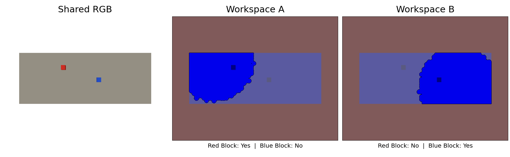

# Workspace Reachability Pairs

An experimental extension of PhysVLM for a concrete question: can a vision-language model use the region of a workspace map that corresponds to the object named in the question?

A simulated Panda scene contains two named targets and two workspace maps. Switching either the target or the workspace changes the certified answer. The same RGB is used across all four questions. A replayed joint-limited IK witness certifies reachable points, and a conservative URDF bound certifies clearly unreachable points.



## Findings

On an initial dual-target test, the released model and the original projector adapters all scored **0/96** views with all four answers correct. The adapters sometimes switched answers in the wrong direction when the workspace changed. A simple target-region map rule scored **96/96**, which checks that the available input contains the necessary signal.

On a separate set of **24 physical layouts and 48 views**, a projector trained to read a target-local RGB and map crop scored **48/48** complete views for both seeds. A color localizer selects the crop in this benchmark. The same target-region map rule also solves this set.

| Training input | Inference input | Complete views, seeds 17 / 29 |
| --- | --- | ---: |
| Full images | Full images | 0/48 · 0/48 |
| Full images | Target crop | 0/48 · 0/48 |
| Target crop | Full images | 0/48 · 0/48 |
| Target crop | Target crop | 48/48 · 48/48 |

The four-way comparison keeps training questions, labels, initial weights, and update count fixed. The full-image control was added after the target-crop results were inspected. The simulation covers free-orientation point reachability with clearly certified labels.

[Target-switch diagnostic and source-distribution control](results/target-alignment/metrics.json) · [Crop repair results](results/target-repair/metrics.json) · [Crossed input comparison](results/target-repair/crossed-input-metrics.json) · [Experiment report](study/后续实验报告.md)

With similar parameter counts (8.92M projector versus 8.99M q/v LoRA) and the same learning-rate search, each adapter improves a different part of the full-image test. LoRA answers more target switches correctly, and the projector answers more workspace switches correctly. Both rarely get all four questions right. [Matched-capacity comparison](results/capacity-comparison/held-out-metrics.json)

## Transfer to the source simulation recipe

On **96 questions from 52 new Panda scenes** generated by the upstream simulator, the frozen model scored **63/96**. Reading the map in the upstream object box, with the frozen model used for missing or ambiguous boxes, scored **86/96**. The improvement is concentrated on unreachable targets. Reachable accuracy drops from 48/48 to 40/48.

The boxes come from simulator metadata, so this measures transfer **given a known target position**. The rule is a reference for evaluating target localization and map reasoning independently.

[Source-transfer metrics](results/source-transfer/fresh-recipe-verifier.json) · [Box preparation](study/prepare_official_box_probe.py) · [Verifier and scoring](study/evaluate_local_verifier.py)

On the earlier 62-query source set, the target-crop adapters given upstream boxes scored **44/62 and 42/62** versus **42/62** for the frozen model on full images. The paired intervals both include zero. [Source-distribution adaptation comparison](results/source-transfer/retrospective-box-probe.json)

## Reproduce

The CPU generator and GPU inference use the same pinned upstream assets.

```bash
git clone https://github.com/jetteezhou/PhysVLM.git upstream
git -C upstream checkout 37e25fd83d8b9f0bdb425661e2dcdffa674a79c7
export PHYSVLM_UPSTREAM="$PWD/upstream"

bash study/setup_cpu_env.sh
pilot_env="${PHYSVLM_PILOT_ENV:-$HOME/.local/share/physvlm-reachability}"
export LD_LIBRARY_PATH="$pilot_env/native/usr/lib/x86_64-linux-gnu${LD_LIBRARY_PATH:+:$LD_LIBRARY_PATH}"
cpu_python="$pilot_env/venv/bin/python"
root=study/outputs/reachability
mkdir -p "$root"
"$cpu_python" study/generate_target_alignment.py "$root/train" --seed 20261271 --repeats 3
"$cpu_python" study/generate_target_alignment.py "$root/dev" --seed 20261272 --repeats 1
"$cpu_python" study/generate_target_alignment.py "$root/test" --seed 20261274 --repeats 2 --yaws 0 -23
for split in train dev test; do
    "$cpu_python" study/prepare_target_repair.py "$root/$split" "$root/crop-$split"
done
"$cpu_python" study/generate_target_alignment.py "$root/test" --audit-only
```

In a CUDA-enabled environment, install the model dependencies and download the PhysVLM checkpoint.

```bash
python -m pip install transformers==4.37.2 tokenizers==0.15.2 accelerate==0.27.2 \
    safetensors==0.5.3 einops einops-exts shortuuid timm==0.6.13
hf download JettZhou/PhysVLM-Qwen2.5-3B \
    --revision 411280628b973db0c1e58d3e1a22c0dda90729d5 --local-dir model

for seed in 17 29; do
    python study/tune_reachability.py projector --model model --seed "$seed" \
        --train "$root/crop-train" --dev "$root/crop-dev" --output "$root/tune-$seed"
    python study/evaluate_target_alignment.py predict --free-only --model model \
        --alignment "$root/crop-test/manifest.json" --checkpoint "$root/tune-$seed/best.pt" \
        --output "$root/pred-$seed"
done
python study/evaluate_target_alignment.py score "$root/test/manifest.json" "$root/metrics.json" \
    "projector17=$root/pred-17" "projector29=$root/pred-29"
```

For the full-image training control, add `--full-image` to the preparation step and use the unmodified test manifest for full-image inference.

To regenerate the source-recipe test, pass `--seed-start 73100 --per-label 48 --max-scenes 128 --robot PANDA` to `study/prepare_official_control.py`. Use `study/prepare_official_box_probe.py` to join the generated questions with unique upstream boxes. Evaluate the frozen checkpoint with `study/evaluate_target_alignment.py predict --official`, then use `study/evaluate_local_verifier.py evaluate` with the [saved development configuration](results/source-transfer/calibration.json).

## References

The S-P Map encoding, checkpoint and source simulation are from [PhysVLM](https://openaccess.thecvf.com/content/CVPR2025/html/Zhou_PhysVLM_Enabling_Visual_Language_Models_to_Understand_Robotic_Physical_Reachability_CVPR_2025_paper.html). This study contributes the paired simulation, the certificate replay, and the adaptation experiments. [Upstream code](https://github.com/jetteezhou/PhysVLM) · [Checkpoint](https://huggingface.co/JettZhou/PhysVLM-Qwen2.5-3B)
