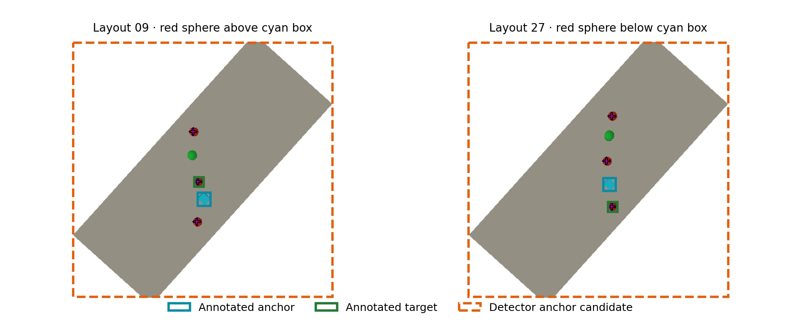

# GroundReach 关系指代与可达性

在新的换锚点确认集上，**用可见标记排除目标作为锚点，再按锚点外观与相对位置排序，正确定位 62/64 个目标，并答对 124/128 道有几何证书的可达性题**。直接使用完整短语检测得到 25/64 和 81/128。可达性准确率增量为 33.59 个百分点，按布局配对重采样的 95% 区间为 25.00 至 42.19 个百分点。四道问答全对的布局从 3/32 增至 30/32。剩余两次定位失败都对应锚点候选缺失，目标候选仍齐全。 [确认集指标](../results/grounding-study/relation-study/anchor-confirmation/metrics.json) · [逐题输出](../results/grounding-study/relation-study/anchor-confirmation/predictions.json)

## 实验怎样区分目标、锚点和地图

每个布局固定相机、RGB 和物体位置，生成两张工作空间地图。每张图提出两个目标不同的问题。锚点绑定按每个 RGB 的两个独立查询计分，物理判断按每个查询的两张地图计分。正例独立重放 Panda 关节限位内的 IK/FK 见证，负例重算 URDF 外界距离。缺乏证书的题保留 U，在定位分母中保留，在有证书的物理分母中排除。

| 阶段 | 布局与设定 | 定位查询 | 有证书的物理题 |
| --- | --- | ---: | ---: |
| 简单关系 | 32 个布局，两件同色同形物体分居一个锚点两侧 | 64 | 112/128 |
| 换锚点开发 | 32 个新布局，三件相同目标与两个锚点交错排列 | 64 | 128/128 |
| 换锚点确认 | 32 个新布局，使用另一组目标与锚点颜色、形状组合 | 64 | 128/128 |

简单关系包含左、右、上、下。由于锚点始终在两件目标之间，只选画面最外侧物体也可能猜对。换锚点实验固定同一张图和方向词，只改「距参照物指定方向最近的目标」中的锚点名称。完全忽略锚点并选择该方向最外侧的物体，在确认集只能对 32/64 个目标，两个目标都定位对的布局为 0/32。

视觉前端沿用固定版本的 Grounding DINO Tiny 与 CLIP ViT-B/32，分数阈值 0.12，IoU 大于 0.7 时去重，最多保留五框。像素读图沿用通道极差阈值 83。算法分别按目标名和锚点名取候选，排除包含目标标记的锚点框，根据框内前景颜色、形状及预训练分数选择锚点，再比较目标标记与锚点框中心的二维坐标，挑选指定方向最近的目标。推理从 RGB 读取标记，仿真框与几何证书用于上界和评分。

## 结果与两次调整

简单关系集上，原始检测、原残差排序和框中心关系规则分别定位正确 36/64、25/64、63/64。一次失误来自候选框中心与读出的标记点分处锚点两侧。回顾性地用标记坐标代替框中心，定位达到 64/64，物理判断达到 112/112。

换锚点开发集上，框中心关系规则为 34/64，提供标注锚点框可恢复到 64/64。用标记坐标做关系比较后为 40/64，加入外观排序为 51/64。排除包含目标标记的锚点框后，按检测器分数选锚点达到 58/64，再加入外观排序达到 64/64。以上分析用于选定确认集上的实现。

| 换锚点确认集方法 | 正确定位 | 两个目标都正确 | 物理题正确 | 四问全对 |
| --- | ---: | ---: | ---: | ---: |
| 完整短语检测 | 25/64 | 3/32 | 81/128 | 3/32 |
| 原残差 MLP，两个种子 | 各 17/64 | 各 0/32 | 各 63/128 | 各 0/32 |
| 自动锚点，框中心关系 | 36/64 | 8/32 | 87/128 | 8/32 |
| 自动锚点，标记点关系 | 45/64 | 14/32 | 109/128 | 14/32 |
| 排除带标记锚点框，检测器排序 | 58/64 | 26/32 | 120/128 | 26/32 |
| 排除带标记锚点框，外观排序 | **62/64** | **30/32** | **124/128** | **30/32** |
| 标注锚点框，框中心关系 | 64/64 | 32/32 | 128/128 | 32/32 |

与同一批布局上的旧框中心关系规则相比，最终方法的定位准确率增加 40.63 个百分点，95% 布局配对区间为 31.25 至 51.56 个百分点。换锚点后两个目标都定位正确的布局由 8/32 增至 30/32，增量 68.75 个百分点，区间为 53.13 至 84.38 个百分点。物理题正确率增量为 28.91 个百分点，区间为 19.53 至 39.06 个百分点。子集间不做直接增量比较。 [布局配对区间](../results/grounding-study/relation-study/anchor-confirmation/paired-comparisons.json)

最终方法在同色双锚点、目标与锚点同色、不同色三层分别定位正确 32/32、16/16、14/16。确认集的目标标记候选召回为 64/64，锚点 IoU≥0.5 的候选召回为 62/64。剩余两次失败都涉及青色方块。正确框不在候选中，方法因此弃答，对应四道物理题。相反标签的换图对双正确为 31/32，换目标对双正确为 30/32。 [简单关系结果](../results/grounding-study/relation-study/simple-relations/metrics.json) · [换锚点开发结果](../results/grounding-study/relation-study/anchor-development/metrics.json) · [确认集证书](../results/grounding-study/relation-study/anchor-confirmation/certificate-audit.json) · [锚点候选审计](../results/grounding-study/relation-study/anchor-confirmation/anchor-candidate-audit.json)



两例对青色方块的检测都只返回一个覆盖大部分画面的框，与标注锚点框的 IoU 分别为 0.0026 和 0.0025。该框包含多个目标标记，被锚点过滤排除。

## 参数与推理耗时

关系绑定新增训练参数为 0。前端复用 172.25M 参数的 DINO Tiny 和 151.28M 参数的 CLIP ViT-B/32。在本地 RTX 4050 Laptop 上只跑最终方法所需的 96 个检测查询，批大小 2。32 张图的检测和 CLIP 两个独立进程分别用时 57.22 和 20.78 秒，均含启动和载入权重。缓存后的 CPU 绑定与读图用时 0.57 秒，两项准确率仍为 62/64 和 124/128。该结果为一次批处理墙钟计时。 [计时与参数工件](../results/grounding-study/relation-study/anchor-confirmation/runtime.json)

## 语言替换诊断

保持候选、视觉特征和含语言条件的 Detector–CLIP 分数固定，只替换残差网络的文本向量。历史标记点任务中，两个种子的首选均改变 7/128 次。种子 17 的正确目标相对错误目标的分数间隔中位数从 1.099 降至 0.529，种子 29 从 1.082 降至 0.555。简单关系集上，两个种子均为 0/64 次首选变化，各只有一条查询出现任意名次变化。固定先验的干预只测残差分支，也可能造成向量与先验的不一致。 [原任务替换逐题数据](../results/grounding-study/relation-study/marked-point-language-swap-17.json) · [关系任务替换逐题数据](../results/grounding-study/relation-study/relation-language-swap-17.json)

## 适用范围与复现

本轮针对带标记、俯视、简单形状、单臂静态平移工作空间的仿真场景。确认集上的关系排序达到候选上限，剩余误差集中在锚点候选缺失。更深的关系网络、全图 LoRA 和局部物理 token 本轮未训练。无标记自然场景尚未验证。

使用固定上游模拟器与[原复现入口所列的 DINO、CLIP 权重](../README.md)。CPU 渲染与 GPU 推理可以使用不同环境。种子 911341 对应换锚点确认集，种子 911339 对应换锚点开发集并移除确认参数，种子 911337 对应简单关系集并同时移除换锚点参数。

```bash
out=study/outputs/relation-confirm-replay
python study/generate_relation_holdout.py "$out" --count 32 --seed 911341 --anchor-switch --confirmation
python study/detect_grounding_targets.py "$out/detector-inputs.json" models/dino "$out/raw-boxes.json" --batch-size 2
python study/score_region_semantics.py "$out/detector-inputs.json" "$out/raw-boxes.json" models/clip \
  "$out/candidates.json" --features "$out/features.pt"
for seed in 17 29; do
  python study/train_region_reranker.py apply "results/grounding-study/reproduction/ranker-$seed" \
    "$out/features.pt" "$out/ranked-$seed.json"
done
python study/evaluate_relation_holdout.py "$out/manifest.json" "$out/candidates.json" "$out/results" \
  --ranker "ranker_17=$out/ranked-17.json" "ranker_29=$out/ranked-29.json"
```

[冻结协议哈希](../results/grounding-study/relation-study/anchor-confirmation/frozen-sha256.txt) · [DINO 文件哈希](../results/grounding-study/relation-study/dino-snapshot-sha256.json) · [CLIP 文件哈希](../results/grounding-study/relation-study/clip-snapshot-sha256.json)

## 通用冻结 VLM 基线

使用 Qwen3-VL-2B-Instruct 的固定 BF16 权重，在换锚点确认集的 32 个布局、128 道问答上复评。所有条件使用相同带标记 RGB、原始可达性地图和地图规则。带框条件给出 V1 自动预测的目标框，以 xyxy 原图像素坐标输入。重放核对了 V1 所选标记，四道无法得到自动框的题计为未作答。使用贪心、8-token 上限和独立 Yes/No 解析。

| 条件 | 正确 / 128 | 未解析或缺框 | 地图反事实双答正确 |
| --- | ---: | ---: | ---: |
| 冻结 VLM，无框 | 69 | 0 | 0/32 |
| 冻结 VLM，自动框 | 4 | 117 | 0/32 |
| V1 自动绑定与规则读图 | 124 | 4 | 31/32 |

带框条件的 124 道有框题中，113 道从解释开头，到 8-token 上限仍未交付答案。自由生成的结果包含提示格式和输出截断效应。RTX 4050 Laptop 全程约 143 秒，峰值 allocated 4,307 MiB。 [协议](../results/grounding-study/relation-study/frozen-qwen3vl-2b/protocol.json) · [逐题输出](../results/grounding-study/relation-study/frozen-qwen3vl-2b/predictions.jsonl) · [布局统计](../results/grounding-study/relation-study/frozen-qwen3vl-2b/metrics.json)

在相同的两套输入上，进一步比较第一个生成位置的 Yes 和 No logits，避免自由生成格式影响。无框组为 **73/128**，自动框组为 **40/128**，自动框组只在 4 道缺框题上未作答。两组在 32 对相反标签的地图反事实中分别双答正确 **0、3 对**，V1 为 **31 对**。自动框组 124 个已作答结果中有 113 个 No，说明修复输出交付后仍存在明显预测偏向。这一结果适用于该冻结权重、坐标文本提示及地图表示，可作为 V2 局部表示的对照。 [候选评分协议](../results/grounding-study/relation-study/frozen-qwen3vl-2b-choice/protocol.json) · [逐题 logits 差](../results/grounding-study/relation-study/frozen-qwen3vl-2b-choice/predictions.jsonl) · [布局统计](../results/grounding-study/relation-study/frozen-qwen3vl-2b-choice/metrics.json)

## 真值定位与地图表示诊断

在相同的 32 个历史换锚点布局上，用同一冻结 Qwen3-VL-2B-Instruct 和 Yes/No 第一个生成位置的候选分数。框和点坐标来自已有几何标注。局部组在 RGB 和地图上取同一窗口，使用窗口内点坐标，并把问句改为直接询问指定点，以免引用被裁掉的锚点。图像输入从固定清单加载并逐张核验哈希。二值地图组复用同一裁剪窗口和问句，将原地图按 V1 的饱和度规则逐像素转成黑白图，并用黑白图例。

| 输入 | 正确题数 / 128 | 地图切换双答正确 / 32 | 布局四答正确 / 32 |
| --- | ---: | ---: | ---: |
| 全图无框 | 73 | 0 | 0 |
| 全图自动框 | 40 | 3 | 0 |
| 全图真值框 | 52 | 5 | 1 |
| 全图真值点坐标 | 76 | 0 | 0 |
| 同步裁剪与裁剪内点坐标 | 64 | 10 | 3 |
| 同步裁剪与二值地图 | 32 | 0 | 0 |
| V1 确定性读图 | 124 | 31 | 30 |

真值框相对自动框多答对 12 道，地图切换双答增加 2 对，按布局配对区间跨零。同步裁剪和点问句一起使用时，地图双答相对全图真值点增加 10 对，即 +31.25 个百分点，布局 bootstrap 95% 区间 [+15.63, +46.88]。该对照同时改变了视野和问句。改用二值地图后模型全部回答 No。结果把后续训练目标收窄到对齐局部区域后读取指定点的物理图信息，当前冻结模型尚无稳定的读图表现。V2 下一次训练应在新布局上以地图切换双答为主指标，采用相同点问句和自动定位输入，比较坐标、原始裁剪和局部物理表示。 [Oracle 逐题输出](../results/grounding-study/relation-study/frozen-qwen3vl-2b-oracle/predictions.jsonl) · [布局配对统计](../results/grounding-study/relation-study/frozen-qwen3vl-2b-oracle/paired.json) · [二值地图逐题输出](../results/grounding-study/relation-study/frozen-qwen3vl-2b-binary-crop/predictions.jsonl)

## V2 物理地图表示与信息利用

本轮先检验原冻结模型对地图变化是否有可读信号。对 32 对标签相反的地图，固定 RGB、问题和目标点，比较地图从不可达到可达时 `logit(Yes) - logit(No)` 的变化。同步彩色裁剪的平均变化为 +0.082，布局配对 95% bootstrap 区间 [+0.035, +0.125]，18 对方向正确、10 对并列。黑白裁剪平均变化为 −0.047，区间 [−0.133, +0.035]，输出全部为 No。黑白组的平均 Yes/No 分差约为 −0.412，彩色裁剪约为 −0.111。当前证据显示黑白提示既使模型偏向 No，也未观察到一致方向的地图响应。原分数来自 BF16 候选 logits，并列会受分辨率影响。 [反事实分差](../results/grounding-study/relation-study/frozen-qwen3vl-2b-oracle/workspace-logit-pairs.json)

### 先控制输入，再定位视觉瓶颈

1. **固定问句检验局部化。** 全图和同步彩色裁剪共用同一条指定点问句、同一图例和候选评分，按输入视野换算坐标。以地图双答正确、分差方向和布局配对区间验收。此前全图与裁剪改变了问句，这个对照用于拆开两项影响。
2. **做同信息的地图对照。** 从同一个阈值成员掩码生成固定双色图和黑白图，固定裁剪、坐标、面积、分辨率与颜色对比度设置，随渲染明确更新图例。保留原始 S-P Map 作为生态基线，再用颜色反转与相应图例复核。原始彩色图可能含强度或背景线索，不能直接把原图与黑白图的差异归给颜色语义。
3. **用同一冻结视觉编码器做可解码性探针。** 先用点附近的冻结地图视觉 tokens 训练线性探针，再在必要时比较同预算小 MLP。记录点所在 patch、邻域与平均池化的对照。固定视觉预处理和点坐标输入，增加只给坐标以及错配地图的对照。独立的几何证书给出标签。训练、选型和确认按物理布局分开，整组 RGB、地图与目标反事实始终留在同一划分，并外留未见资产组合。主指标为确认集地图切换双答与布局 bootstrap 区间。
4. **按瓶颈决定训练层。** 若同信息掩码能被视觉探针稳定解码，而冻结问答仍弱，优先在相同自动框、点坐标和文本提示下比较坐标 LoRA、普通裁剪 tokens、局部图 tokens 加轻量投影。真实优势应在交换局部地图时随标签翻转，打乱或移除地图 tokens 时下降。若视觉探针也弱，先检查 patch 尺寸和点附近的采样分辨率，做像素掩码的轻量空间编码器对照。
5. **距离场回答独立问题。** 从同一二值掩码在局部窗内构造有符号二维像素距离场，作为成员信息的平滑派生表示。由已采样三维工作空间构造的最近距离减阈值包含附加几何信息，应单独评估，并继续用 IK/FK 证书验收。三维采样距离是针对既有采样和阈值的代理量。

探针结果只能回答某组特征能否预测指定点的状态。是否能用于 VLM 的回答，由独立布局上的问答和地图干预检验。

匹配问句的全图点坐标对照已完成。它在 128 题上答对 96 道，主要来自 127/128 次预测 Yes，地图切换双答只有 1/32。同步彩色裁剪用相同的指定点问句，地图切换双答为 10/32。这将局部输入的反事实收益与问句简化分开，整体正确率仍受当前确认集 Yes/No 比例影响。 [匹配问句逐题结果](../results/grounding-study/relation-study/frozen-qwen3vl-2b-point-control/predictions.jsonl)

### 冻结视觉特征探针结果

确认训练范围只用已有开发集的 32 个布局、128 条几何标注。冻结 Qwen3-VL 视觉编码器，以固定正则拟合小型线性读出。输入为地图本身。分别取覆盖指定点的合并视觉 patch 或对区域所有视觉 tokens 做均值。双色与黑白条件来自相同的成员掩码。对训练数据以外、使用不同资产组合的布局，另生成两个随机种子的模拟场景，种子 911347 用于定位探针是否依赖裁剪构图，种子 911351 确认共享裁剪结果。两个资产组合清单互斥，RGB 哈希无重合。

点中心裁剪中，三种地图的全局池化都通过了 32/32 地图切换。这项结果存在裁剪随目标一起变化的线索。进一步把同一场景与同一地图里的两个点放入**完全相同的裁剪窗口**，只切换取样的视觉 patch。下表只用新种子 911351 的 32 个布局。

| 读出方式 | 正确题 / 128 | 同图换目标双答 / 32 | 同目标换地图双答 / 32 |
| --- | ---: | ---: | ---: |
| 原始彩色图，点位置特征 | 128 | 32 | 32 |
| 原始彩色图，区域均值 | 96 | 0 | 32 |
| 等信息固定双色图，点位置特征 | 95 | 17 | 16 |
| 等信息黑白掩码，点位置特征 | 77 | 9 | 12 |
| 仅坐标 | 62 | 9 | 0 |
| 冻结通用 VLM 问答，共享彩色裁剪与真值点 | 69 | 2 | 1 |
| 规则读取指定像素 | 128 | 32 | 32 |

两种简化编码的区域均值同样都是同图换目标 0/32、同目标换地图 32/32。因此均值特征捕捉了工作空间变化，但固定地图改问另一个点时没有可用的点选择。原始彩色图在同一裁剪窗口和同一冻结视觉塔上的点位置特征可线性恢复该模拟任务的标签，而该 VLM 的坐标文本问答未充分使用这条信号。双色和黑白探针使用同一掩码，仍可能受颜色分布与预处理影响。原始图与掩码的信息量也有区别。独立回放验证了确认集 96 个可达 IK 见证和 32 个不可达几何界，最大 FK 误差 1.24 mm。 [线性探针及分层结果](../results/grounding-study/relation-study/physical-map-probe-point-confirm/metrics.json) · [同题冻结 VLM](../results/grounding-study/relation-study/frozen-qwen3vl-shared-point-confirm/metrics.json) · [配对区间](../results/grounding-study/relation-study/physical-map-probe-point-confirm/paired.json)

根据这批结果，首选 V2 输入为原始彩色图中按点索引的冻结视觉 tokens。先比较同维度、同数量的点位置 tokens 与区域均值 tokens，使用相同的轻量投影预算接入冻结语言模型。各条件共用同一个自动定位器，真值点仅做诊断上界。继续保留坐标与普通裁剪基线，并报告自动点错位时的端到端损失。两个反事实均稳定改善以后，再研究是否需要放开少量 LoRA 参数或加入不同地图编码。生成与运行入口为 [布局生成器](generate_relation_holdout.py) 和 [特征探针](probe_physical_map_features.py)。两次额外集合分别使用 `--anchor-switch --physical-probe --count 32 --seed 911347` 和种子 `911351`。共享裁剪参数为 `--shared-target-crop`。

## Point-conditioned token 训练小试

沿用冻结 Qwen3-VL-2B-Instruct 的视觉合并输出。附加物理向量替换聊天模板末尾追加的一个普通文本 token 的 embedding。原 RGB、地图、视觉占位数、DeepStack 和位置编码使用 Qwen3-VL 的现有路径。自动定位器给出指定点，两个查询的可用预测点共同定义裁剪窗。缺失指定点计作未答。输入点内的视觉 token 与区域均值各使用一个等维 token，两个残差适配器各有 133,152 个可训练参数，32 维瓶颈，其余参数冻结。训练只对 Yes/No 候选的相对 logit 使用交叉熵。16 题接口小试确认原生模型与缓存视觉前向的候选 logits 精确相同，训练期间冻结主干没有梯度，保存重载后的 logits 精确复现。

训练、开发和首次确认分别使用 104、20 和 32 个仿真布局，图像哈希互斥。每个布局有四题，分别组织为交叉翻转、双可达、双不可达、两点共同随地图翻转。三个集合各自标签对半。确认使用不同物体组合。开发集用于检查生成与定位流程，未用于调训练参数。双不可达场景允许两张地图的像素恰好相同，条件是两个位姿下的不可达均通过独立几何认证。首轮 layout pattern 在生成时与关系方向循环耦合，追加轮改变两者对应关系以检验结论。 [训练与评估代码](train_physical_token.py) · [配对分析](summarize_physical_tokens.py) · [首次确认清单与证书](../results/grounding-study/point-token-pilot/point-token-confirm)

| 种子 17，自动点输入 | 正确题 / 128 | 同图换点双答 / 16 | 同点换地图双答 / 32 | 布局四答 / 32 |
| --- | ---: | ---: | ---: | ---: |
| 坐标与同步裁剪 | 79 | 3 | 10 | 12 |
| 直接注入均值 token | 67 | 0 | 0 | 8 |
| 直接注入点 token | 61 | 0 | 0 | 6 |
| 残差适配均值 token | 106 | 0 | 17 | 21 |
| 残差适配点 token | 122 | 16 | 31 | 29 |
| 同一自动点的规则像素读出 | 122 | 16 | 31 | 29 |

点适配相对均值在地图双答上提升 43.75 个百分点，按布局配对区间 [+21.88, +65.63]。目标切换只有八个独立交叉布局，16/16 的结果对新增布局的稳定性需要结合复核。自动定位覆盖 122/128，122 个已定位点全部和参考点一致。其余 6 道计为未答。固定原始 RGB、地图、坐标与问句，把附加点 token 换成同一目标在另一张图上的 token，地图双答从 31/32 变为 0/32。点 token 若直接注入，模型未出现稳定的反事实响应，轻量适配对此任务有实测贡献。训练和评估在本地 RTX 4050 Laptop 进行，峰值约 4.93 GiB，准备输入、两组训练和推理共约 318 秒。 [逐题预测、配对区间及适配器](../results/grounding-study/point-token-pilot/point-token-automatic)

种子 29 在打散布局类型与关系方向对应的新确认集上，点适配达到 126/128，同图换点 16/16，同点换地图 32/32，均值适配对应 93/128、0/16 和 14/32。地图双答提升 56.25 个百分点，布局配对区间 [+31.25, +81.25]。另两道未答题的自动点缺失，其余预测与规则像素读出完全一致。替换为另一张地图的点 token，使地图双答再次降到 0/32。结果仍来自可见标记的静态 Panda 仿真，自动定位对轻微错位的敏感性需要单独测试。 [打散布局的小试结果](../results/grounding-study/point-token-pilot/point-token-automatic-permuted)

将两个已训练适配器分别放到另一套确认集上，固定权重与输入协议交叉复评。种子 17 在打散集得到 125/128、换点 16/16、换图 31/32，均值对应 100/128、0/16、18/32。种子 29 在首次确认集得到 122/128、16/16、31/32，均值对应 106/128、0/16、15/32。两套布局和两个种子的对照均支持显式选择目标点的视觉 token。所有组均冻结原视觉和语言模型。本轮以该投影作为 V2 的模型实现，LoRA 只在有新数据证明投影难以处理错点或分布变化时重新评估。 [种子 17 交叉结果](../results/grounding-study/point-token-pilot/point-token-cross-check-17) · [种子 29 交叉结果](../results/grounding-study/point-token-pilot/point-token-cross-check-29)

复现数据按 `--anchor-switch --balanced-points` 渲染。训练、开发和首次确认依次为 911361、911363、911367，分别生成 104、20、32 布局。首次确认加 `--physical-probe`。打散确认用种子 911369、32 布局，另加 `--physical-probe --vary-pattern-direction`。依次用固定版本运行 DINO 候选、CLIP 打分和 `evaluate_relation_holdout.py`，将其 `predictions.json` 作为训练脚本的 `--train-predictions` 和 `--test-predictions`。训练脚本默认一轮，`--seed` 决定初始化和题序，`--load-heads` 可直接复评已保存的两个残差头。

自动点的像素扰动复查使用固定种子 711。对同场景同目标施加同一个 8 像素的单轴平移，工作空间切换时保持偏移一致，共用裁剪随输入坐标重新计算。权重和标签不变。种子 29 的点适配从 126/128 降到 116/128，换点仍为 16/16，换图从 32/32 到 30/32，布局四答从 31/32 到 26/32。本数据上相同扰动的规则读出维持 126/128。该检查表明，在本次偏移尺度下，神经读出比原规则更受定位扰动影响。后续要扩展到更难的布局，应先用真实近边界点和定位误差验证，而不是立刻提高模型容量。 [8 像素扰动与配对统计](../results/grounding-study/point-token-pilot/point-token-jitter)
