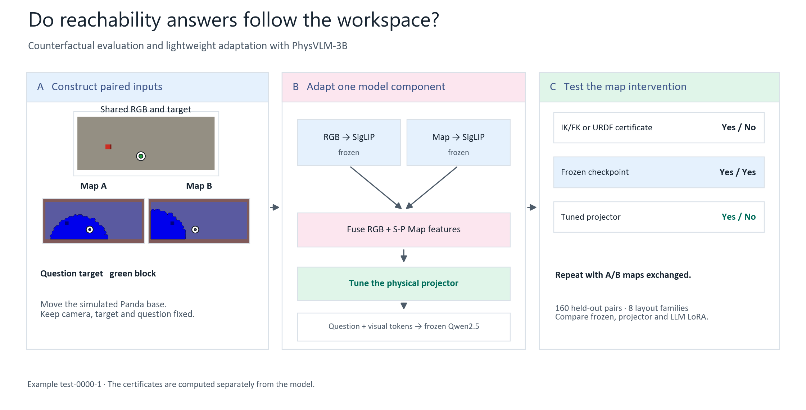
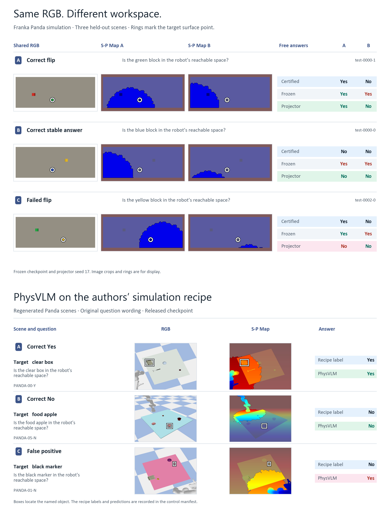

# PhysVLM 工作空间迁移实验

## 官方分布正对照

官方仓库提供了仿真验证数据的生成配方及请求示例。固定版本没有可独立运行的作者服务端入口。本实验调用固定版本的仿真及 S-P Map 生成函数，在确定性场景种子下重新生成样本，按每图每类至多一问选取 64 条问答。用独立离线加载器加载发布的 BF16 权重，两条视觉支路和投影层的参数均无缺失。原问题及追加 “Answer Yes or No.” 的问题使用相同 RGB 和地图。答案在模型测试前确定。

| 数据与提示 | 自由生成答对 | 不可达答对 | 独立 Yes/No 候选答对 | 给定共同前缀后的候选答对 |
|---|---:|---:|---:|---:|
| 官方配方，原问题 | 42/62 | 11/31 | 45/62 | 39/62 |
| 官方配方，加回答指令 | 45/62 | 14/31 | 48/62 | 40/62 |
| v1 方块配对复查，原问题 | 16/32 | 0/16 | 16/32 | 16/32 |
| v1 方块配对复查，加回答指令 | 16/32 | 0/16 | 19/32 | 16/32 |

结果复核发现 PANDA 场景 23 中两个不同实例规范化为同一物体名称，形成相同输入而标签相反的两问。报告主表按输入与问题去除这两项，保留 31 正、31 负。原始 64 条预测完整保留，包含这两项时自由生成分数分别为 43/64、46/64。

复查覆盖四类各四对 v1 场景。两种提示下 v1 自由生成均为 Yes，与原始 320 条预测一致。原问题在官方配方场景已能输出可达和不可达两类正确答案，支持推理链路具备输出 No 的能力。v1 增加指令后，普通候选打分恢复了部分有用区分，但在模型常生成的共同控制标记之后做条件判别，正确率仍为 50%。自由生成和强制二选一分别报告。

候选概率在相同助手边界逐 token 求和，分数相等记无效。典型 v1 输出 token 为 151643、7414、151643。首个候选 token 的强制前向概率与生成步概率单独比对。官方配方对照用时 51.77 秒，PyTorch 峰值分配 9,231 MiB。重跑 v1 子集用时 31.44 秒。两者均运行在同一张 RTX 6000D。

原始问答、逐条概率、生成 token、输入哈希及日志位于本地 `study/outputs/official-control-20261124/` 和 `study/outputs/next-rtx6000d-20261124/`。生成配方和模型固定版本见方案及复现入口。[作者仿真配方](https://github.com/jetteezhou/PhysVLM/tree/37e25fd83d8b9f0bdb425661e2dcdffa674a79c7/EQA-phys-simulator)

## 数据重建与位置捷径

补全 v1 README 后重生成 160 个场景，选择清单 SHA-256 与历史文件一致，160 张 RGB 的 SHA-256 全部逐张一致。v2 使用独立生成目录。每个目标表面像素所属的四场景区组包含 YN、NY、YY、NN 各一次，区组内随机分配目标颜色、干扰物及配对顺序。基座以目标附近或远处的位置分层构造，随后由 IK/FK 正证书与 URDF 外界证书确认。三个集合各自具有相同的标签条件像素分布，任何仅使用这两个像素坐标的确定性配对类别预测器，在每个集合的正确率均为 25%。这是受控仿真分布，外界证书样例特意避开了难以认证的边界。

训练、验证、测试分别包含 256、64、160 对，合计 960 个单侧证书。利用记录的关节角独立重放后，最大末端误差为 1.34 mm，URDF 外界的最小不可达余量为 187.3 mm。只用 RGB 颜色及位置特征的浅决策树在验证集为 23/64、留出集为 44/160。该诊断支持原横坐标捷径已消除，验证集的结果也提示 RGB 偏差仍值得监测。

只使用 RGB 按颜色定位，再用目标区域 S-P Map 色彩范围作阈值判定的几何基线，在训练、验证和留出测试集上分别正确 255/256、64/64、160/160 对。阈值 83 仅在训练集拟合。使用目标三维坐标的点云对照在三个集合均全对。这些结果确认观察图中有足够信号，并体现了当前生成场景的几何难度。

## 目标区域诊断

冻结模型在 64 对验证数据上比较整图、同步裁剪目标、同步裁剪干扰物。裁剪由 RGB 颜色分割定位，RGB 与 S-P Map 共用同一裁剪框。

| 输入 | 自由生成翻转对双正确 | 自由生成稳定对双正确 | 无共同前缀的 Yes/No 打分翻转对双正确 |
|---|---:|---:|---:|
| 整图 | 2/32 | 16/32 | 9/32 |
| 目标裁剪 | 1/32 | 16/32 | 18/32 |
| 干扰物裁剪 | 7/32 | 18/32 | 9/32 |

整图与目标裁剪下，32 个翻转场景的候选分数移动方向全部正确。目标裁剪提高了候选判别的双正确率，但自由生成未改善。干扰物裁剪改变了模型的回答倾向，其自由生成双正确率反而更高，因此自由生成的变化无法单独解释为目标对齐的改善。干扰物框中有 7 对仍包含目标中心。按相同规则在三组排除这些场景后，候选打分的翻转对结果为整图 5/26、目标 13/26、干扰物 5/26。此敏感性分析以目标中心是否进入框为准，框边上的部分目标仍可能残留。

## 真实微调与留出布局

冻结双视觉塔与语言模型，物理投影层更新 8,916,992 个参数。该层接收串联的 RGB 和 S-P Map 特征。语言 LoRA 只修改语言模型各层的 q_proj、v_proj，共 1,843,200 个可训练参数。两组采用相同的 512 条训练问答、相同的独立答案交叉熵和三个训练轮次，每次 8 条有效问答。训练选择依据是验证集两项双正确率的等权平均，验证最高分并列时选更早的一轮。

| 方法 | 正确地图 翻转双正确 | 正确地图 稳定双正确 | 交换地图 翻转双正确 | 不可达误报 |
|---|---:|---:|---:|---:|
| 冻结 PhysVLM | 1/80 | 40/80 | 0/80 | 157/160 |
| 物理投影层 17 | 65/80 | 65/80 | 0/80 | 15/160 |
| 语言 LoRA 17 | 54/80 | 61/80 | 0/80 | 50/160 |
| 物理投影层 29 | 67/80 | 66/80 | 0/80 | 16/160 |
| 语言 LoRA 29 | 56/80 | 62/80 | 0/80 | 24/160 |

物理投影层相对冻结模型的翻转双正确率差为 +80.0 和 +82.5 个百分点。按同像素四场景区组做 10,000 次配对 bootstrap，区间分别为 ［+70.0，+88.75］和［+73.75，+90.0］个百分点。按 8 个留出布局族重采样得到相同方向。交换地图保留原标签，稳定对的双正确率依定义保持不变，翻转对的收益消失。两侧喂同一张地图时，确定性生成无法同时答对两侧的相反标签。交换和固定地图使用同一道问题的逐侧输出重组，保持 RGB、问题与模型配置一致。

这些结果支持在当前仿真与留出布局中，轻量监督训练使模型的自由回答能够响应工作空间地图。两种微调均有效，物理投影层两轮结果均更高。两组可训练参数规模不同，同一学习率也未为每组单独搜索，因此把差异解释为本设置下的实测对照。简单图像几何规则达到 160/160，说明本数据有意选用了易认证的工作空间差异，不能据此推断真实机器人场景整体性能。独立答案交叉熵实验也没有隔离配对组织对训练的额外贡献。

物理投影层两个种子的训练耗时分别为 248.73 和 244.71 秒，语言 LoRA 分别为 265.08 和 272.68 秒。各组均为 192 次更新，耗时含组内验证，单组峰值 PyTorch 分配约 9.9 GiB。训练、验证选择与留出测试逐场景输出均已回传并检查文件 SHA-256。可查看 [测试与地图干预指标](../results/matched-v2/held-out-metrics.json)、[数据审计](../results/matched-v2/dataset-audit.json) 和 [官方配方正对照](../results/matched-v2/official-metrics.json)。

## 双目标与相机旋转留出评测

每个物理布局包含两个颜色不同的物体和两个 Panda 基座。在同一张 RGB、同一张工作空间地图中，询问不同物体时应当改判。固定目标并切换工作空间地图时，也应当改判。四个查询组合来自同一个物理布局。每个布局渲染原方向和旋转 27° 的俯视相机，共 48 个物理布局、96 个视图、384 条查询。颜色组合平衡，测试图像与上一轮训练、验证及测试无哈希重叠。冻结权重与两个既有投影层权重固定。

192 个可达证书逐一重放关节角，最大末端误差为 1.31 mm。192 个不可达证书的最小 URDF 外界余量为 266.09 mm。目标区域规则从 RGB 定位被询问的颜色，在对应地图区域计算色彩跨度中位数，并沿用上一轮训练拟合的阈值 83。全图基线对同一地图的两个问题只能给出相同预测。颜色覆盖和证书审计在模型推理前完成。

主读数分别为同图同地图的目标切换双正确率、同图同问题的地图切换双正确率，以及同一视图的四问全正确率。配对区间以物理布局为单位，两个相机视图随同一布局一起重采样。另在原作者配方再生成的控制数据上，用同样的提示与解码比较三个固定权重，报告去除两条输入冲突样本后的结果。

[几何证书审计](../results/target-alignment/certificates.json) · [留出集生成](generate_target_alignment.py) · [评估入口](evaluate_target_alignment.py)

| 方法 | 单问正确 | 同图同地图换目标双正确 | 同图同目标换地图双正确 | 四问全正确 |
|---|---:|---:|---:|---:|
| 冻结 PhysVLM | 191/384 | 0/192 | 0/192 | 0/96 |
| 投影层 17 | 192/384 | 8/192 | 38/192 | 0/96 |
| 投影层 29 | 190/384 | 3/192 | 33/192 | 0/96 |
| 全图地图色彩跨度 | 192/384 | 0/192 | 0/192 | 0/96 |
| 目标区域地图色彩跨度 | 384/384 | 192/192 | 192/192 | 96/96 |
| 目标三维点与工作空间点云 | 384/384 | 192/192 | 192/192 | 96/96 |

两组投影层仍能在部分场景随地图正确改判，地图切换双正确率相对冻结权重分别提升 19.79 和 17.19 个百分点，布局配对区间分别为 +15.10 到 +24.48 和 +11.98 到 +22.40 个百分点。目标切换的增益只有 +4.17 和 +1.56 个百分点，对应区间为 +1.56 到 +6.77 和 0.00 到 +3.65 个百分点。两个投影层在地图切换时还分别有 38 和 35 对朝错误方向翻转。单问正确分别为 192/384 和 190/384，冻结权重为 191/384。原相机方向的 96 个目标切换对上，两个投影层都为 0/96；旋转视图上分别为 8/96 和 3/96。种子 17 的裸 Yes/No 候选分数中，96 个视图的可达与不可达对数分数交互项有 64 个为正，种子 29 有 43 个。先在各视图对两个可达组合和两个不可达组合分别平均，再相减，可抵消独立的目标偏好和地图偏好。加入常见共同标记后，正向计数分别为 55 和 48。候选分数未提供跨种子一致的定位证据。

| 作者配方样本 | 原问题自由生成 | 追加 Yes/No 指令 | 原问题不可达答对 | 显式指令不可达答对 |
|---|---:|---:|---:|---:|
| 冻结 PhysVLM | 42/62 | 45/62 | 11/31 | 14/31 |
| 投影层 17 | 29/62 | 31/62 | 2/31 | 15/31 |
| 投影层 29 | 30/62 | 35/62 | 2/31 | 13/31 |

原作者配方上的冻结权重复现了上一轮离线正对照。两个微调权重在两种提示下的总体正确数均下降。结合双目标留出结果，已有证据支持投影层适配在原单目标、基座变化的仿真里改善自由生成对地图的响应。新测试进一步限定了适用范围，目标与其局部地图的可靠对应仍然缺失，适配收益未迁移到这批作者配方样本。两个新视图共享同一物理布局，且负标签是容易认证的外界点。实验范围为点可达性和俯视图旋转。

[留出测试与作者配方指标](../results/target-alignment/metrics.json)

## 目标局部对齐与投影层再训练

此前的双目标诊断显示，整图中地图变化常引起回答翻转，其中正确和错误方向接近；只替换问题里的目标时很少能正确改判。新流程从问题读取目标颜色，在原 RGB 上寻找对应颜色的最大连通区域。红色掩码排除黄色区域。随后用同一裁剪框分别提取 RGB 和空间地图，不向模型输入三维坐标、证书标签或目标区域的规则判定。局部框包含指定目标的证书像素，并在本组几何审计中排除了另一个目标中心。该定位器依赖仿真颜色和对象命名方式。

训练与验证分别使用 36 和 12 个新物理布局（288、96 问），渲染 0° 和 +27° 两种俯视方向。每个视图的两个目标在两张地图下组成四个标签交叉的查询。仅更新原模型物理投影层的 8,916,992 个参数，两种子各训练三轮，每轮 36 次更新。按验证集四问全正确率选取最早最佳轮次。最终测试另生成 24 个物理布局（48 个视图、192 问），渲染 0° 和 −23°，其中 −23° 在训练和验证中均未出现。最终数据与前一轮实验、开发和初步诊断数据无 RGB 哈希重叠。96 个可达证书独立重放后的最大末端误差为 1.29 mm，96 个不可达点的最小外界余量为 273.14 mm。

留出对照包括冻结权重和原版投影层种子 17，各自评估整图和同样的目标裁剪。新投影层使用目标局部输入。所有主表指标来自模型的自由生成。训练只使用普通答案交叉熵，配对用于数据构建和验证集选择。

[裁剪和配对预处理](prepare_target_repair.py) · [投影层训练](tune_reachability.py) · [最终证书](../results/target-repair/final-certificates.json)

| 权重与输入 | 单问正确 | 同地图换目标双正确 | 同目标换地图双正确 | 四问全正确 |
|---|---:|---:|---:|---:|
| 冻结权重，整图 | 96/192 | 0/96 | 0/96 | 0/48 |
| 冻结权重，目标裁剪 | 96/192 | 0/96 | 0/96 | 0/48 |
| 原投影层种子 17，整图 | 94/192 | 0/96 | 14/96 | 0/48 |
| 原投影层种子 17，目标裁剪 | 67/192 | 1/96 | 1/96 | 0/48 |
| 新投影层种子 17，目标裁剪 | 192/192 | 96/96 | 96/96 | 48/48 |
| 新投影层种子 29，目标裁剪 | 192/192 | 96/96 | 96/96 | 48/48 |
| 目标区域色彩跨度规则 | 192/192 | 96/96 | 96/96 | 48/48 |

种子 17、29 的最佳权重分别来自第 1、2 轮，验证集都是 24/24 个视图四问全对。两组分别耗时约 175 和 189 秒，包含组内验证。两个新权重在 −23° 的 24 个视图也都四问全对。给冻结权重或旧投影层使用相同裁剪，四问全对率仍为 0/48，表明相同裁剪输入的适配训练对当前修复有贡献。本轮未使用新训练数据训练整图投影层，因而仍无法分离同样的新训练在整图输入上的效果。

结果适用于通过颜色命名定位的仿真双目标点可达性。裁剪没有把规则的 Yes/No 直接交给模型，且规则在该留出集上也达到满分。当前优先级是将目标定位扩展到较复杂的物体和指代表达，并在独立分布上比较裁剪定位、局部地图读数和新模型。当前结果未涉及真实机器人执行，也未对新局部模型重评作者配方的非色块对象。

[同场景对照指标](../results/target-repair/metrics.json)

## 整图与局部训练的交叉对照

补上两组整图训练后，完成训练视野和推理视野的交叉对照。整图组和局部组复用 288 个训练问题、96 个验证问题、标签、训练顺序与最佳轮次规则。测试使用此前已查看过的 48 个视图，属于回顾性的受控比较。

| 训练输入 → 推理输入 | 单问正确 17 / 29 | 固定图换目标双正确 17 / 29 | 固定目标换图双正确 17 / 29 | 四问全正确 17 / 29 |
|---|---:|---:|---:|---:|
| 整图 → 整图 | 91/192 · 100/192 | 6/96 · 9/96 | 19/96 · 34/96 | 0/48 · 0/48 |
| 整图 → 目标局部 | 92/192 · 1/192 | 1/96 · 0/96 | 1/96 · 0/96 | 0/48 · 0/48 |
| 目标局部 → 整图 | 91/192 · 97/192 | 16/96 · 2/96 | 4/96 · 2/96 | 0/48 · 0/48 |
| 目标局部 → 目标局部 | 192/192 · 192/192 | 96/96 · 96/96 | 96/96 · 96/96 | 48/48 · 48/48 |

整图训练加整图推理时，两种子在固定地图的 96 个目标切换对中，分别有 79、82 对给两个对象相同答案，另有 11、5 对朝错误方向翻转。因此，目标区域的区分在组合指标上形成明显瓶颈。局部输入与相匹配的训练都对当前改进有贡献。原图与裁剪图之间直接换输入会失去这项能力。

[交叉对照指标](../results/target-repair/crossed-input-metrics.json) · [配对场景示例](../results/target-repair/crossed-example.png)

## 作者配方上的外部分布校验

为了区分可达性判断与目标定位，使用上游保存的物体三维包围盒投影，按原名称对应唯一实例，再读取地图局部。地图色彩跨度仍沿用此前训练集拟合的 83 阈值。旧作者配方的 62 题用作开发集选择是否保留分数边距回退，选中的边距是 0。最终管线规则为框可取得时读取局部地图，框缺失或歧义时回退到冻结的整图 PhysVLM。框由仿真器提供，实际使用需要独立的目标定位器。

最终测试从上游固定代码生成 52 个新 Panda 场景，按同样规则抽取 48 个可达问题和 48 个不可达问题。新旧数据 RGB 哈希不重叠，使用相同的上游物体目录。96 道原问题的自由生成，冻结 PhysVLM 答对 63 道，局部几何校验加缺框回退答对 86 道，提升 23.96 个百分点。按场景配对重采样的 95% 区间为 +13.83 到 +33.33 个百分点。不可达问题从 15/48 改善到 46/48，可达问题从 48/48 降到 40/48。94 道独立框可用的问题中，局部阈值基线为 85/94，整图冻结为 62/94。

这一结果支持在上游仿真里验证「给定目标位置时，局部地图比冻结模型的回答更适合作为可达性校验」。规则会带来一部分误拒，且本实验的定位来自仿真元数据。它说明可以用局部校验改善原配方实测表现，适配后的模型权重是否独立迁移需要看后面的对照。

[外部校验指标](../results/source-transfer/fresh-recipe-verifier.json) · [上游目标框转换](prepare_official_box_probe.py) · [局部规则和回退](evaluate_local_verifier.py)

### 原 62 题目标框诊断

| 方法 | 原问题 | 显式 Yes/No | 原问题可达正确 | 原问题不可达正确 |
|---|---:|---:|---:|---:|
| 冻结模型，整图 | 42/62 | 45/62 | 31/31 | 11/31 |
| 旧投影层 17，整图 | 29/62 | 31/62 | 27/31 | 2/31 |
| 旧投影层 29，整图 | 30/62 | 35/62 | 28/31 | 2/31 |
| 冻结模型，作者投影框 | 35/62 | 36/62 | 30/31 | 5/31 |
| 局部训练种子 17，作者投影框 | 44/62 | 48/62 | 21/31 | 23/31 |
| 局部训练种子 29，作者投影框 | 42/62 | 44/62 | 17/31 | 25/31 |
| 新整图训练种子 17，整图 | 30/62 | 33/62 | 19/31 | 11/31 |
| 新整图训练种子 29，整图 | 4/62 | 23/62 | 3/31 | 1/31 |

局部训练权重在作者配方上恢复到整图冻结的总体正确数附近，并减少不可达误报，同时增加对可达目标的误拒。原问题下两组相对冻结的按场景配对区间分别为 −10.17 到 +16.67 和 −16.13 到 +15.00 个百分点。现有 62 题不足以建立局部微调模型的总体迁移增益。更稳健的外部结果来自独立 96 题上用上游目标框的几何校验。本轮以自由生成作为源分布诊断的主要读数；对局部权重约束打分时，个别样本在生成与强制前向的首 token 概率上超过预设容差，后续整组用同一自由生成入口复测。

[源分布模型诊断](../results/source-transfer/retrospective-box-probe.json)

## 参数规模可比的整图 LoRA 对照

用完全相同的整图训练、验证和测试输入比较物理投影层与语言 q/v LoRA。rank 39 的语言 LoRA 更新 8,985,600 个参数，投影层为 8,916,992，相差约 0.77%。两者各在种子 17 的验证数据评估学习率 3e−5、1e−4、3e−4。以四问全对率选最佳轮次，学习率优先按该指标、再按地图切换对数、再按是否等于原始学习率选定。两者都选出 1e−4。以同样选择规则评估种子 17、29，每组训练 108 次更新。测试固定为此前已读的 24 个物理布局。

| 方法 | 单问正确 17 / 29 | 同地图换目标 17 / 29 | 同目标换地图 17 / 29 | 四问全正确 17 / 29 |
|---|---:|---:|---:|---:|
| 投影层 | 91/192 · 100/192 | 6/96 · 9/96 | 19/96 · 34/96 | 0/48 · 0/48 |
| 语言 q/v LoRA | 98/192 · 108/192 | 14/96 · 23/96 | 13/96 · 18/96 | 0/48 · 1/48 |

语言 LoRA 在只换目标的对照上两次更好，物理投影层在只换地图的对照上两次更好，四问一致性都很低。参数规模和学习率搜索预算接近时，证据不支持投影层全面优于 LoRA。结果限于整图输入与本实验学习率范围；局部输入上的 LoRA 尚未比较。

[开发集学习率选择](../results/capacity-comparison/validation-selection.json) · [等预算对照结果](../results/capacity-comparison/held-out-metrics.json)
